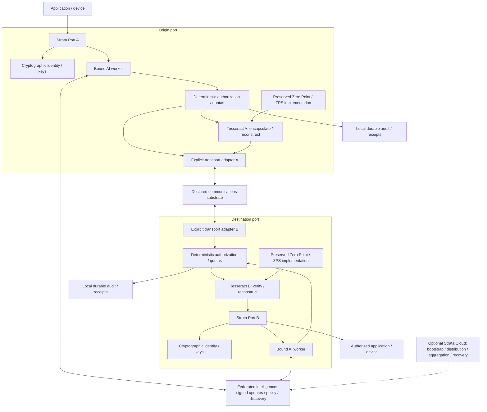

# Founder master directive — implementation reconciliation

Authority and origin: **Kindred Jermaine Cox / Kindred Labs**.
Source: founder's Master Architecture Directive supplied 2026-10-13.
This is an implementation reconciliation, not a claim that all requirements exist.

## Controlling architecture

**Strata Port + Tesseract + Bound AI Worker + Federated Intelligence + Cryptographic
Identity + Explicit Transport Substrate.** Native identifiers contain no conventional
IP destination addresses. SDPN's logical protocol performs no conventional IP packet
routing. Underlying adapters are replaceable and must disclose the real carrier,
reachability, IP/routing dependencies, security boundary and measured performance.
Strata Cloud is optional; already-discovered, authorized, reachable peers must not
depend on an online cloud coordinator.

The teleportation model is protected state encapsulation and verified reconstruction.
It does not prove instantaneous transmission, another physical dimension, absence
of information transfer, or elimination of an underlying physical path.

Each port must have cryptographic identity, Tesseract state engine access, a bound AI
worker, deterministic policy enforcement, and a versioned adapter. The worker proposes
intent and optimization; it is not the authorization authority. Tesseract and worker
remain distinct so verified reconstruction does not require the worker to be alive.

## Requirements retained

- Preserve existing Zero Point, STRATA-TESSERACT-1, Port Zero, ZPS, SDPN names, source,
  seals, test vectors, benchmarks and additive lineage; verify before integration.
- Tesseract supports versioned binary/structured state, authenticated encryption,
  integrity commitments, replay/lifecycle controls, quotas, crash recovery,
  independent verification and secure-deletion policy. Arbitrary binary data must
  reconstruct byte-for-byte; vectors alone are not assumed lossless.
- Cryptographic identities need peer trust/consent, device binding, secure key custody,
  revocation and rotation. Self-signed discovery records establish key identity only.
- Bidirectional and concurrent sessions use equivalent deterministic security rules.
- Separate federated training/aggregation, signed model dissemination, peer discovery,
  authorized session synchronization, and signed policy/version distribution.
  Never train/distribute private payloads, credentials or session secrets.
- Model updates require trusted signing, compatibility, controlled rollout, rollback,
  privacy protection and defenses against malicious/offline/incompatible participants.
- Test mutual authentication, modern encryption, forward secrecy, post-quantum migration,
  device keys, replay/impersonation/DoS, worker sandboxing, poisoning defenses, quotas,
  signed software, audit/recovery and revocation. No immunity claim follows from no IP.
- Global operation requires geographically separated executed endpoints. Compare
  declared Internet, direct wireless/optical, dedicated infrastructure, hybrid adapters
  and reproducible novel mechanisms; distinguish abstraction from physical elimination.
- Platform-native Windows/Linux/Android/iOS/tablet/XR/embedded/industrial integration
  must obey OEM/driver/carrier/OS privileges. Signals reflect verified service health,
  not fictional coverage; a third-party app cannot replace OS-owned radio indicators.
- Benchmark end-to-end and local processing separately: latency/p95/p99, throughput,
  exactness, expansion/compression, CPU/RSS, energy, setup/recovery, security overhead,
  retransmissions, coverage, cost per GB and failure/regulatory/commercial constraints.
- Every capability needs repo/commit/files, commands/output, environment, test vectors,
  actual security/performance/deployment receipts, limitations and next action.
  Documents, unit tests and simulations do not prove production global operation.

## Contradictions resolved

| Earlier assumption | Current decision |
|---|---|
| Every carrier must eliminate IP immediately | Logical namespace/protocol is IP-independent; adapters declare all underlying dependencies. Non-IP physical elimination remains research. |
| Native CloudSignal must require an IP packet gateway | Native health requires verified reciprocal reconstruction/authorization plus explicit adapter metadata. |
| Strata Cloud must coordinate each session | Peer authentication/coordination is native. Cloud may bootstrap/support; it is not the security authority or payload relay. |
| New grants/identity records establish a complete Tesseract port | They are control-plane foundations. Original Tesseract, bound AI and complete data-plane composition remain separate gates. |
| Reference hash or vector is sufficient to reconstruct arbitrary unknown data | Receiver needs verified existing state or actual encoded information through a declared adapter. |

## Complete component diagram

Solid arrows are required architectural relationships, not assertions that every
component is implemented. The inventory below states actual evidence for each.



## End-to-end sequence

Port participants below include the worker and separate deterministic enforcement;
the component diagram makes that separation explicit. Both directions can operate
concurrently through independently sequenced channels; native-session tests exercise
two outstanding opposite-direction frames, not global concurrent delivery.

```mermaid
sequenceDiagram
  participant A as Origin port / worker / policy
  participant TA as Tesseract A
  participant X as Explicit transport adapters
  participant B as Destination port / worker / policy
  participant TB as Tesseract B
  A->>A: Authenticate application and authorize intent
  A->>A: Verify signed destination record and capabilities
  Note over A,B: Signed identity discovery does not prove physical reachability
  A->>X: Signed session offer with native port IDs
  X->>B: Deliver control over disclosed substrate
  B->>B: Verify identity, consent, replay, expiry and quotas
  B->>X: Signed acceptance with ephemeral key
  X->>A: Deliver acceptance; mutually derive session keys
  A->>TA: Encapsulate authorized data into versioned state
  TA-->>A: Protected state, manifest and integrity commitments
  A->>X: Transfer necessary encoded state information
  X->>B: Measured actual carrier delivery
  B->>TB: Verify, reconstruct and atomically publish
  TB-->>B: Exact output hash and durable result
  B->>X: Authenticated completion receipt
  X->>A: Receipt bound to session and state
  A->>A: Verify receipt; update durable session status
  Note over A,TB: Reverse operation uses the same controls with sender/receiver roles exchanged
```

## Verified component inventory before further replacement

| Component / files | Inspected source/evidence | Actual status |
|---|---|---|
| SDPN Python ports/contracts/HTTP transport | Imported tree pinned to Superstructure `1cd44b93c2bc1f924fbda5f7717ec491ec590aeb`; candidate CI | Preserved candidate; underlying HTTP/IP. No complete global Tesseract port proof. |
| Unified Quad Direct Pipe | Imported tree pinned to `999bf2c51da3d014d71150e2295287128a57e63a`; focused CI | Preserved portable buffered baseline; not physical zero-copy. |
| SW06-E worker transfer and state port | `src/direct-pipe-worker-transfer.mjs`, `src/kindred-state-port.mjs`, executable tests | Local worker ownership transfer and reference planning verified; reference mode does not prove remote state availability. |
| SW06-F encrypted transport | `src/two-machine-proof.mjs`, sender/receiver, executed QEMU proof | Two actual VMs on one physical host, explicit TCP/IP. Original SW02 remains two-process loopback. |
| SW06-G qualification | Benchmark/PowerShell scripts and tests | Executable physical-host kit; no distinct physical-host/global execution receipt. |
| ZPS SW03 successor | Private Superstructure `8f636c2fd0a7146c4e170a4490dacbac7e844c64`, source SHA-256 `02fb06e8414faf164d0bd41d6595681edbb8f595a78b0dd8f28c49991aa485f1` | Exact encrypted-object reconstruction; native OS recovery/soak checks and source-pinned local benchmarks. Original Core/Protocol dependency qualification remains open. |
| SW09 direct non-IP adapter | Private Superstructure PR #13; workflow `38468025125` | 11/11 checks; kernel socket denial and traced zero networking attempts. Local pipe carrier only; no physical/global or original Tesseract integration. |
| Native cryptographic identity/discovery | `src/native-port-identity.mjs` and `test/native-protocol.test.mjs` | Ed25519-derived port IDs; signed expiring records, bounded directory, revocation/revision checks. Advertisements do not prove device control or component execution. |
| Native peer-session foundation | `src/native-session.mjs` and executable tests | Signed mutual offers/acceptances, X25519 ephemeral keys, direction-bound AES-GCM, deterministic consent, expiry/replay/frame bounds. Local cryptographic tests; no deployed global data plane. |
| Existing Tesseract V2 core | Library `10-Build-KindredStrataTesseractV2-v6.ps1`; generator SHA-256 `3814de525258f9ad96c18a78f3d2dafd46e4bae1d20283bdd021ed4190456ec2`; Superstructure [PR #15](https://github.com/KindredKJ/kindred-labs-superstructure/pull/15), head `83353307e5863453bc88de8135faa73635842b16` | Seven Contracts/Core source files recovered unchanged; .NET 10 build and 25 local checks pass. Eleven-field coordinate and nine-check planner are real; complete binary reconstruction is not established. |
| Original sealed STRATA-TESSERACT-1 | Historical founder receipts; recovered V2 relationship remains unconfirmed | Preserve; require receipt/source/seal matching before canonical integration. V2 namespaces differ from ZPS's required original dependencies. |
| Bound AI worker / federation | Declared contract; existing Unified Quad/UMR work preserved | Actual model binding, sandbox, signed training/aggregation/distribution and poisoning/rollout tests are pending. A Node worker thread is not proof of AI/federated learning. |
| Orchestration/recovery / topology | Existing SDPN draft PR #18, head `51d9862be3286a077b00d395cb96139c2d19ea3e` | Separate unmerged work; single-writer coordinator is not a required global Strata Cloud. Do not duplicate or silently replace it. |
| Android / INTERCONNECT | SW07/SW08 source and CI | Debug apps/native rendering candidates; native phone carrier and continuous trusted health are not qualified. Native clouds remain disconnected. |
| Global deployment / production | No geographically separated integrated receipt found | Pending. No global security, recovery or production readiness claim. |

## Controlled waves and next gates

1. Audit exact repositories/artifacts and recover original Tesseract/Core/Protocol.
2. Bind the preserved Tesseract to a versioned wire-independent port contract and exact
   binary/structured reconstruction vectors; distinguish declarations from execution.
3. Bind actual AI workers behind deterministic authorization; qualify isolation, signed
   discovery/policy/model distribution, offline operation, compatibility and rollback.
4. Compose peer sessions + original Tesseract + an explicit adapter. Measure concurrent
   bidirectional data plane; no-cloud-required peer sessions must survive support outage.
5. Exercise corruption/replay/loss/partitions/malicious workers/key rotation/crash/recovery,
   persistent replay defense and physical power-loss boundaries.
6. Deploy authorized test endpoints in distinct geographic locations with declared
   infrastructure, measured costs/latency/tails/throughput and signed receipts.
7. Qualify consumer/enterprise SDKs, native device permissions, telemetry, commercial
   controls, operational recovery and external production authorization.

Native-session handshake replay protection is currently process-local. Durable replay
and recovery must be composed with the existing orchestrator or a qualified persistent
store before production. Node KeyObjects provide software keys, not verified secure
hardware key custody or guaranteed memory erasure. Post-quantum suites, key rotation,
model poisoning defenses and global/federated measurements are not implemented here.
Self-signed v1 discovery component bindings accept only `DECLARED` status; they cannot
self-promote Tesseract or worker execution to locally/independently verified evidence.
The recovered legacy signature helpers verify keys supplied by the envelope/receipt;
expected-peer trust pinning must be enforced before accepting untrusted transitions.
The current native policy separately pins permitted peer IDs, state hashes and exact
adapter descriptors; workers cannot select an undeclared adapter or absent capability.
