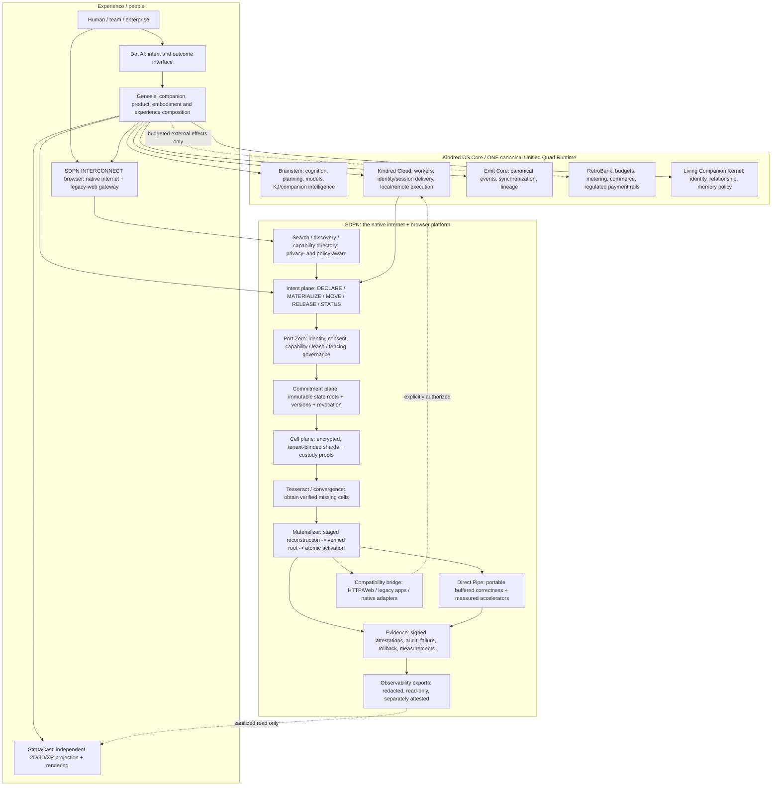

# SDPN as a next-generation internet — Genesis-native ecosystem architecture
**Status:** Target architecture / engineering constitution, NOT a released network
**Product authority:** SDPN is the network **and its first-party browser/discovery environment**. Genesis is the companion-first universal interaction and product-composition experience. Neither replaces the canonical Kindred OS Core runtime.
**Provenance:** Strata Software-Only End-to-End Implementation Blueprint v1 (2026-09-01); Kindred Labs Superstructure Master+++ Blueprint v1.0 (2026-07-20); Genesis white-paper doctrine recorded there; SDPN current branch artifacts and PR #17; StrataCast PR #24.

## Corrected north star

**Existing internet:** An application asks the transport to SEND packets to a named remote host and translates responses back into application state.

**SDPN:** A user, agent or program DECLARES an authorized state or capability, with desired presence and policy constraints; SDPN verifies identity, manifest, commitments, reconstruction potential, freshness and exclusive-activation rights, then MATERIALIZES the state at an appropriate port. Underlying networks and physical links still carry previously unknown bits: no violation of information causality is asserted. The application does not own route, host, region, copy or storage decisions. SDPN can also provide an ordinary HTTP/Web compatibility gateway.

**Browser:** INTERCONNECT is SDPN's first-party, non-Chromium-by-design browser and web/discovery experience, not an unrelated browser bolted to SDPN. Provide both existing-web access and native state/capability navigation. The original local encrypted SDPN app is preserved as an independent secure tool, not the internet UI. A browser shell must not become an authorization root.

**Genesis:** Genesis is the universal companion / intention-to-outcome experience atop the network and Kindred OS Core. It can compose dynamic app-replacing workflows, views, social and spatial experiences, while delegating only specifically consented capabilities. It remains a canonical *composition and activation protocol*, not a fifth runtime quadrant or a second identity/event/memory/ledger stack.

## System of systems

## Precise responsibilities / non-duplication

| Domain | Canonical owner | SDPN-facing interface | Prohibited shortcut |
|---|---|---|---|
| Companion intention, adaptive interfaces, product activation | Genesis + Dot AI + Living Companion Kernel | `MaterializationIntent`, scoped capabilities, presence / continuity receipts | Genesis as unrestricted superuser or second runtime |
| Cognition / orchestration / model routing | Brainstem / uDECA / UMR as their canonical runtime components | capability and state materialization through versioned adapters | Putting model weights, reasoning, or open-ended code execution inside the browser core |
| Identity, leases, exclusive presence | Port Zero SDPN authority + canonical IAMIX / runtime identity contracts | signed audience/purpose-bound capabilities, nonce, expiry, fencing | Treating cell custody or Web session login as activation rights |
| Event lineage / application outcomes | Emit Core | correlation IDs, idempotent receipts, semantic lifecycle events | parallel SDPN business event bus that conflicts with Emit |
| Durable state | Domain owner + encrypted SDPN cell fabric | blinded content commitments, state roots, tenant-bound capsules | unhashed overwrite of source ledger or cross-tenant plaintext dedup |
| Compute and presence | Kindred Cloud / distributed workers / Zero Point | compatible worker capability proof, atomic materialization | assuming state transfer teleports GPU compute or breaks causality |
| Rendering and spatial embodiment | StrataCast | independent signed read-only topology / scene contracts | renderer granting SDPN identities or mutating authoritative world state |
| Search and next-gen browser | SDPN INTERCONNECT | search index, capability resolver, native materialization UI and legacy-web adapter | Chromium dependency or untrusted web origin gaining Port Zero authority |
| Money, tokens, fees | RetroBank / delegated rail integrations | explicitly budgeted, approved payment capabilities | automatic value creation or companion-triggered treasury movements |
| Ops and production approvals | Founder governance / verified policy | audit gates, signed release manifest, canary, restore proof | promoting mock, QEMU, CI-only evidence to physical global release |

## SDPN user-experience contract

1. **Navigate intentions, not only URLs.** Browser omnibox accepts conventional URL, a native SDPN capability identity, a verified state reference, search query or authorized task intent; differentiates interpretation visibly before execution.
2. **Discover without surveillance.** Decentralizable, privacy-preserving discovery with opt-in personalization, provenance and index-policy choice; no implicit public indexing of private ports or their addresses.
3. **Open a state, not merely a file.** Prefer native `MATERIALIZE` to stage a verified state locally and display as document, service, application view, companion workflow, or 3D world according to capability and device resources. Always retain legacy-web fallback.
4. **Continue an experience across ports.** Cross-device state and identity continuity requires verified commitment roots and capability checks. Exclusive sessions need quorum-issued lease and monotonic fencing tokens; offline read-only can remain available according to policy.
5. **Generate the right surface.** Genesis can assemble task-specific UI and companion interactions from signed capability manifests without installing a conventional siloed app; sensitive effects require consent and independent authority.
6. **Prove what happened.** Status `SIMULATED`, `LOCALLY_VERIFIED`, `PHYSICALLY_ATTESTED`, `DEPLOYED` or `UNKNOWN` must be backed by distinct receipts. Low-level underlay may use IPC, QUIC, shared memory or other existing physical transport; no faster-than-light claims.
7. **Survive faults.** Full commitment verification before atomic publish; old presence retained until commit; corrupted fragments quarantined; restore independently reproducible. Performance optimization never changes correctness.

## Execution contract / decisive milestone gates

**Stage A (existing PRs):** single-writer orchestrator, hashed durable journal, schema registry, sanitized topology export, independent StrataCast consumer and Babylon observatory. Signed attestations are candidate code on PR #18; local files are not proof of deployed trusted identity. Keep main and production clean until verification.

**Stage B (the real internet primitive):** implement canonical, versioned `MaterializationIntent`, `StateId`, `CellId`, `Capability`, `PresenceLease`, `StateRoot`, `Receipt`; use audited AEAD and signatures; enforce tenant-separated cells, Merkle root, exact cryptographic receipts and pre-publication verification. Demonstrate three independent ports with actual trusted source and destination and no central data server after dispersion.

**Stage C (genuinely new browser):** ship INTERCONNECT native sandboxed browser with conventional-web compatibility and native SDPN state resolver; guarded web-origin to Port Zero capability mediation; indexed discovery, accessibility, security and performance parity gates. Current PR #17 native WebKitGTK evidence is a sandbox proof, not browser distribution.

**Stage D (universal Genesis experience):** companion intent -> authorized capability -> SDPN state materialization -> approved tool execution -> adaptive StrataCast UI -> independently verified outcome -> cross-device continuity. Build one rights-cleared end-to-end vertical slice before expanding. Preserve founder approval and financial rails gates.

**Stage E (release):** require separately attested independent physical host tests; chaos, restoration, signed provenance, RPO/RTO and p50/p95/p99 baseline comparisons; independently passing CI (including private StrataCast); then controlled canary only after explicit approval.

## Current repository implementation status

- SDPN PR #18: implementation candidate, tests green on current branch, not main or production.
- SDPN PR #17: separately passing private two-QEMU-VM encrypted transfer and native INTERCONNECT proofs; both VMs on one physical host.
- StrataCast PR #24: opt-in local Babylon topology viewer and contract consumer candidate; native hosted CI is blocked before steps start (StrataCast issue #23).
- SDPN production readiness issue #19: unresolved physical, trust, restore, governance and public network gates.
- A browser capable of replacing the internet, a global state materialization network, and a generally app-replacing Genesis companion have **not** been demonstrated. This document defines the route, not the completion claim.

## Design integrity
The above is an additive architecture decision, not a retroactive reclassification of existing measurements, claimed ownership, or public production. Do not overwrite original Genesis white papers or source ledgers. Never reclassify a compatibility rendering interface as an operative public network.
