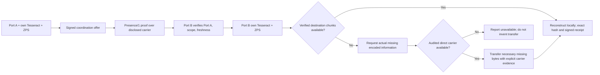

# SDPN/2 — Full-Stack Next-Generation Networking Engineering Charter

**Founder authority:** numeric Port 0 exclusively. Every other Port retains regular/admin scope *only over itself*. Original ZPS/Tesseract/PORT/1/SW02–SW09 evidence and implementations are preserved, not overwritten.

**North-star outcome:** a global, independently reproducible distributed computing and communications ecosystem in which every Port carries its own identity, Tesseract, runtime, storage bindings, AI worker and permitted host capabilities. Cryptographic coordination and actual state delivery are separate planes. A receiving Port reconstructs state locally, verifies every byte and issues its own receipt.

**No-routing requirement, precisely:** Native Mode STRICT rejects all adapters that disclose underlying IP or routing, and SDPN itself does not select packet routes or relay third-party application payload. That does NOT prove an unmeasured adapter's physical operation is genuinely route-free. Existing globally routed Internet infrastructure cannot satisfy a blanket *no underlying routing anywhere* constraint. Global direct communication of **new information** still requires a verifiable physical delivery channel; a Tesseract manifest/hash cannot replace missing entropy. Any separate Internet compatibility mode must state its carrier honestly and is not STRICT.

## 1. SDPN stack — each layer must beat a measured baseline

| Layer | Existing foundation | Next-generation target / invention hypothesis | Quantified qualification |
|---|---|---|---|
| L0 Device + energy | Native host assimilation, device capability manifests | PORT-HOST: permission-aware CPU/GPU/NPU/RAM/storage/radio broker, per-port local resource contracts | CPU/RSS/energy overhead, startup, drive correctness, hardware coverage |
| L1 Physical carrier | Native driver declarations; direct-pipe tests | PORT-CH: independently audited direct wireless/optical/USB/serial/native physical adapter family | Actual independent hosts, range, RF/optical limits, no routing audit |
| L2 Link | Adapter descriptors, AES-GCM frames | PORT-LINK: interchangeable, authenticated native frame link with capability-bound receipt and loss recovery | p50/p95/p99, packet loss, hardware dependency manifest |
| L3 Native address | Ed25519 Port IDs and PORT/1 URI | PORT-ID: transport-agnostic, self-certifying identity and signed, permanent numbering | Collisions, bootstrap, restore, revocation and key rotation tests |
| L4 Local authority | Port 0 signed ledger, self-scoped regular/admin | PORT-POLICY: Port 0 exclusive founder actions; independently enforced local admin; hardware permission binding | Exhaustive cross-port privilege denial, compromised worker test |
| L5 Global awareness | Signed local registry, signed Tesseract presence *declarations* | PRESENCE/1: challenge/response on real carrier, signed liveness evidence and registry consistency witnesses | False-positive rate, expiry/replay, geographic measured availability |
| L6 Coordination | Native session crypto, state reference offer | PORT-COORD: identity-bound offers/consent, short leases, anti-replay, host-pinned exact recipient | Auth latency, impersonation, partition and offline recovery |
| L7 Representation | Kindred State Port, Tesseract candidates | TESSERACT-STATE: deterministic, versioned binary encodings; zero ambiguity about metadata vs bytes | 100% random/structured binary exactness, size expansion |
| L8 Destination reconstruction | Reference-only Tesseract adapter, original ZPS lineage | PORT-REBUILD: destination-local content-addressed chunks, lossless reconstruction, atomic publish, integrity proofs | cold-cache/restored-cache p50/p95/p99, bitwise match |
| L9 Novel information delivery | Existing TCP/IP proof explicitly marked routed | PORT-DELTA: cryptographic state-availability negotiation and minimal missing-byte delivery *only over qualifying direct carrier* | Information lower bound, actual unique bytes carried, channel audit |
| L10 Durable storage | ZPS SW03 candidate, snapshots/receipts | ZPS/2: erasure-coded, transactional local content ownership, append-only proofs, crash-safe restore | power-loss tests, durability, dedupe, restore times |
| L11 Compute scheduling | Bound worker contract, local machine catalog | PORT-COMPUTE: locality-aware execution at the Port, no implicit movement of private state | task success, tail latency, watts/task, cost/task |
| L12 Intelligence | Declared bound-worker integration | PORT-MIND: local-first AI agent with signed capabilities, verifiable tool receipts and durable memory | autonomous task completion, tool permission isolation |
| L13 Applications | PORTAL, INTERCONNECT, portable encrypted workspace | PORT-APP: native signed services, static content, developer SDK, compatible browser/app workflows | real user task completion, cold-start, a11y, security |
| L14 Observability | SW06/07 evidence and receipts | PORT-PROOF: signed trace lineage, audit retention, repeatable two-host+geo distributed reports | independent reproducibility, receipt coverage, tamper tests |
| L15 Operations | GitHub CI, physical host kits | PORT-FLEET: safe local enrollment, versioned OTA, rollback, monitoring and fleet health | update success, recovery time, host isolation |
| L16 Commerce | Community open-core, managed plans catalog | PORT-MARKET: optional isolated paid storage/compute/sites/managed coordination; free native core | verified paying tenants, cost-to-serve, margin, SLA |

**Superiority is measured, never asserted:** qualify against actual baselines: ordinary LAN/WAN file delivery, QUIC/WebTransport, rsync/content-addressed sync, standard local OS IPC, cloud object storage, distributed file systems and device-level management. Use identical hardware, payloads, configuration, location, cost window and methodology. Publish negative results.

## 2. Exactly three separately verified claims

1. **Logical Native No-Routing:** No application packet forwarding or IP addresses inside SDPN's logical representation; native Port ID / state coordination is independent of IP. A compatibility transport does *not* invalidate this narrow protocol property, but must disclose routing.
2. **Physical STRICT Route-Free:** Independently witnessed underlay traces prove that a particular direct peer exchange used no routers or network packet forwarding. A descriptor with `underlyingRouting:false` is a declaration only, never proof. Direct physical distance is limited by actual link budget.
3. **Global Native Availability:** Independently geographically separated ports exchange signed coordination and independently verified new data with physical provenance, durability, and end-to-end reconstruction. This is **not achieved** and cannot be inferred from a signed registration, local pipe, VM, LAN Wi-Fi or prepositioned data.

Native STRICT Mode must never fall back to routed TCP/IP, HTTP, QUIC, VPN, relay, cloud tunnel or proxy; doing so would break the strict claim. Network compatibility mode, if ever offered, is separate and visibly marked **ROUTED_UNDERLAY**.

## 3. Proposed full operational workflow

Port 0 is the sole founder / numbering authority. It is **not** required to remain in the byte path or to manage a normal Port's local applications. Every Port has its own Tesseract, local policy, host drivers and worker. An optional globally reachable presence index may distribute signed attestations, but it must not be called a route-free global physical link without executed carrier measurements.

## 4. Immediate implementation: PRESENCE/1

Files: `src/port-presence-proof.mjs` and `test/port-presence-proof.test.mjs`.

- A registered local Port creates a nonce-bound, short-lived signed challenge for an explicitly numbered destination.
- The target independently verifies founder-pinned registry status, challenger signature, expiry, nonce and declared route-free adapter, and signs a response.
- The challenger verifies the response's identity, exact challenge hash, peer number, chain head and clock bounds; a local pending-challenge tracker allows just one accepted response.
- Neither handshake contains an application payload or calls an IP transport. Both exchange participants must supply an actually working external carrier to deliver the signed bytes.
- The verified result explicitly reports `globalReachabilityVerified:false`, `physicalCarrierIndependentlyAudited:false`, `routeFreePhysicalTransportVerified:false` and `destinationTesseractReconstructionVerified:false`. These are correct until real external evidence exists.
- The challenge registry is in-memory and does **not** withstand process restart yet; durable replay handling and witness checkpoints are separate work.

This improves trust coordination but **does not** construct global connectivity. On an isolated machine the cryptographic routines still run, yet there is no independently connected second device or global claim.

## 5. Execution roadmap by proof gates

**Gate A — Stable Port runtime:** merge founder-anchored identity + role isolation only after CI, sign-off, canonical Tesseract compatibility, reboot/restore and persistent registry tests. Native host module reports actual mounted volumes/app services; complete each device-class adapter with capability/permission contracts.

**Gate B — Proof-grade destination materialization:** recover and integrate canonical original Tesseract/ZPS interface, add durable chunk-availability protocol, source/destination anti-replay, delta planner, cold-cache tests, exact output bytes and append-only lineage.

**Gate C — Real native carrier:** implement one direct Windows–Android or Linux–Android interface supported by both devices, audit OS packet forwarding, verify signed PRESENCE/1 from two physical hosts, time real control and materialization trials. Keep no-routing mode strict; an unqualified phone OS/radio combination is a measured blocker.

**Gate D — Experimental global substrate:** choose an actual physical global mechanism, budget link coverage and infrastructure, demonstrate independent long-distance propagation of previously unknown content without forwarding, record signal/provenance. Without such a path, a global route-free claim is **blocked** even when the coordination registry is global.

**Gate E — SDK, fleet and revenue:** ship native Port installer/updates, PORTAL+INTERCONNECT sites, isolated managed coordination, signed service catalogs, developer API, private-vs-public boundary, usage metering and paying pilots. Commercial applications can launch before blanket physical global no-routing is proven, with exact carrier labels.

## 6. Validation, ownership and delivery

- Preserve existing production, project lineage, keys and DNS; develop through branches/PRs with meaningful isolated tests.
- Inventory existing modules before replacing them, particularly original Tesseract/Zero Point / ZPS and their approved source receipts.
- Readiness is **IMPLEMENTED / TESTED / TWO_REAL_HOSTS / GEO_VERIFIED / PRODUCTION_VERIFIED**, never a single invented green state.
- Port 0 alone can sign global founder policy / numbering; normal Port admins cannot elevate across ports, and workers cannot grant themselves capabilities.
- Absolutely no assumption that a mathematical reference hash can create previously unknown information; quantify actual entropy transmitted.

**Product positioning:** SDPN's defensible near-term innovation is *endpoint-first state networking*: sovereign numbered ports, per-device capability assimilation, cryptographically coordinated local reconstruction, partial/delta state transfer where warranted, strong evidence receipts and optional managed discovery. The physics of truly global, fully route-free transport remains a distinct high-risk research challenge, not a released feature.
