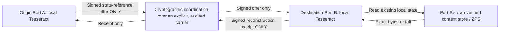

# SDPN — strict no-routing split-plane materialization candidate

## Controlling topology



Every port owns a local Tesseract. **Port B reconstructs locally**, not inside a shared coordinator.
Port 0 is uniquely founder-authoritative; numbered ports have port-local regular/admin authority.
A local admin cannot administer another port or act as founder.

## Strictly separate planes

**Coordination plane:** `src/tesseract-reference-coordination.mjs` uses existing Ed25519
port identities, signed expiring peer records and deterministic native session policy.
The sender signs a one-time offer naming the recipient cryptographic Port ID and
a content-hash manifest. The receiver independently checks identity, authorization,
expiry, anti-replay and an explicitly non-IP, non-routed adapter descriptor. After
local reconstruction, it signs an exact SHA-256 receipt. The offer and receipt contain
no source payload bytes. They carry hashes, sizes, authorization metadata and
session binding only. These messages still need delivery by an **actual carrier**.

**Destination Tesseract plane:** `reconstructFromLocalState(manifest, resolveLocalChunk)`
asks the receiver's **local storage API** for verified 64 KiB content-addressed
chunks, recomposes arbitrary binary bytes and checks full-state SHA-256.
The injected `resolveLocalChunk` callback is the integration boundary for the
preserved ZPS/Tesseract implementation. This module is a **reference-only adapter**;
it is not a replacement for the existing original Tesseract, SW02, SW03 or their
independent recovery/persistence tests.

**Strictly non-routed hardware boundary:** `src/native-hardware-adapters.mjs`
inspects host interface names without importing IP addresses; a device-specific
driver must explicitly declare non-IP, direct, non-forwarding operation and obtain
OS permissions. A declaration or detected adapter does not establish a connected
peer, range, actual non-routing or globally available materialization. Driver
probes and capability lists are a foundation, **not finished Windows/Android
native radio drivers**. The strict coordination API rejects any descriptor
with `underlyingRouting=true` or `underlyingIp=true`. It does **not**
silently fall back to TCP, VPN, Wi-Fi IP or a relay.

## Executable classification

The first proof deliberately **prepositions destination chunks before any
coordination**. The source signs a small manifest, the destination uses only its
pre-existing state, and a signed reconstruction receipt returns.

- **PASS means:** correct binary reconstruction from pre-existing destination
  bytes, signed control-plane separation, no application payload transported by
  this particular operation and no IP/routed adapter in the tested descriptor.
- **FAIL means:** a required local chunk is missing or changed, a signature or
  authority is wrong, a session is replayed, control expires, or a routed adapter
  is requested.
- **It does NOT mean:** a previously unknown file arrived worldwide without a
  physical carrier, transport latency was zero, zero physical bytes crossed the
  infrastructure, or that any remote Port is globally reachable. The local tests
  have no proof of physical network connectivity whatsoever.

The finite digest of a new, otherwise unknown arbitrary file does not contain
enough information to reconstruct that file. A globally distributed presence/
coordination service can enable session discovery, but it cannot make a
disconnected recipient obtain never-before-seen bytes merely from a hash.

To achieve worldwide reach for **novel** data while absolutely avoiding routing,
SDPN would require an independently validated physical substrate that provides
actual global point-to-point propagation. On ordinary hardware, direct wireless
transports have finite range and OS radio privileges. Internet-based global
coordination can be offered as a *separately labeled compatibility mode*, but
that mode **uses routed infrastructure** and cannot satisfy the strict
no-routing claim.

## Run verified software tests

From the SDPN checkout using Node.js 22+:

```bash
node --test test/tesseract-reference-coordination.test.mjs
node --test test/port-roles-hardware.test.mjs
npm test
```

The tests check binary and empty-object exactness, missing/changing chunks,
cryptographic signatures, wrong destination, signed receipts, replay rejection,
routing-adapter rejection, non-founder local-admin isolation and driver
permission checks. These are software-executed tests, not a physical global proof.

## Next real integration gates

1. Bind `resolveLocalChunk` to the **unchanged**, qualified canonical ZPS/Tesseract
   storage code with durable chunk ownership and cold-start reconstruction.
2. Pin the authenticated founder Port 0 key and prove non-founder regular/admin
   isolation from durable signed roles.
3. Build and independently audit real native OS platform adapters, starting with
   a compatible direct radio or physical non-IP peer mechanism; measure actual
   signals, range and hardware permissions. No simulated socket fallback.
4. Demonstrate real separate-device signed control exchange and exact reconstruction
   from verified prepositioned state; report the prepositioning mechanism explicitly.
5. Invent and test any proposed alternative global propagation mechanism with
   independently measured information delivery. If unknown content can be
   reconstructed, document where the missing information was actually supplied.
6. Only label an installed port ONLINE when reciprocal signed liveness,
   authorization, explicit carrier reachability and independent reconstruction
   receipts are observed. A signed registry entry alone remains DECLARED.

No DNS, firewall, tunnels, production routing, secrets, payment systems or
live services are modified by this change.
